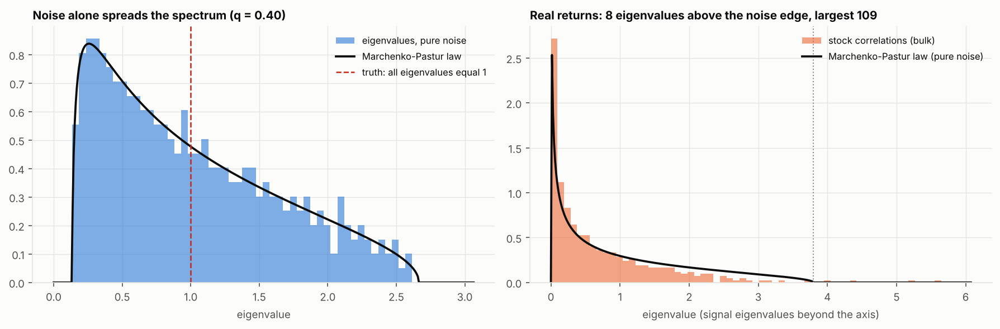
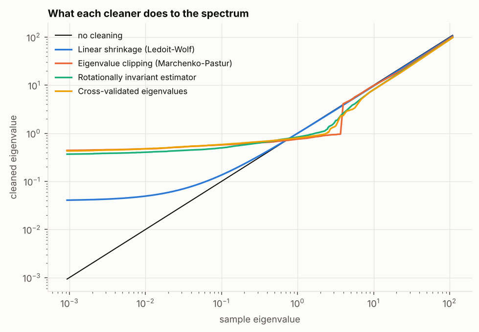
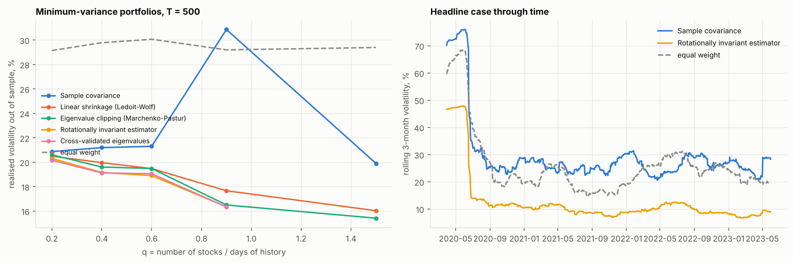

# RMTClean

**Random matrix theory for covariance matrices: the Marchenko-Pastur law, eigenvalue clipping and the rotationally invariant estimator, implemented from scratch and tested out of sample on 1,455 Nasdaq stocks. With 450 stocks and two years of data, cleaning the correlation matrix halves the realised risk of a minimum-variance portfolio.**

  

Every risk model, optimiser and capital allocation rests on a covariance matrix estimated from too little data. Physicists met the same problem in the 1950s with the energy levels of heavy nuclei, and solved it with random matrix theory: the spectrum of a large noisy matrix is predictable, so noise can be told apart from signal and removed. Applied to stock correlations (Laloux, Cizeau, Bouchaud and Potters 1999), the theory says that with N assets and T observations almost the whole sample spectrum is noise unless N / T is tiny, and it gives the optimal correction.

1. **Check the theory**: simulated noise against the Marchenko-Pastur law, and each estimator against a known true matrix.
2. **Look at real data**: how much of the spectrum of stock correlations is signal?
3. **Measure what matters**: out-of-sample risk of minimum-variance portfolios, 2020-2023, for N / T from 0.2 to 1.5.

```bash
pip install -e ".[dev]"
python -m rmtclean run    # writes reports/report.md, validation.md, metrics.json, oos_results.csv, figures/
pytest                    # 9 tests
```

---

## Headline results

| | Finding |
|---|---|
| **Theory holds to three decimals** | For pure noise (N = 400, T = 1,000) every true eigenvalue is 1; sample eigenvalues run from 0.14 to 2.62, against a predicted 0.14 to 2.66. Distance to the Marchenko-Pastur law: 0.006. |
| **98% of the spectrum is noise** | For 450 stocks over 500 days, 442 of 450 eigenvalues lie inside the noise band. Eight carry information; the largest (the market) explains 24% of the variance. |
| **Risk cut by 47%** | Minimum-variance portfolio, 450 stocks, 500 days of history, 2020-2023 out of sample: realised volatility **30.9%** with the sample covariance, **16.3%** with the rotationally invariant estimator. The uncleaned "optimised" portfolio is riskier than holding every stock equally (29.2%). Significant in each of three random universes (t = 4.4, 4.6, 6.7). |
| **Risk forecasts 5 to 6 times less wrong** | The sample covariance predicted 2.3% volatility for a portfolio that delivered 30.9%, a factor 13. Cleaned estimators are off by a factor 2.4, the residual being the COVID crash at the start of the test period, not estimation noise. |
| **Gain grows with N / T, as predicted** | Volatility reduction vs the sample matrix: 3% at N / T = 0.2, 10% at 0.4 to 0.6, 47% at 0.9, and 23 to 40% beyond 1, where the sample matrix is singular. Cleaning never hurt. |
| **Matches the theoretical ceiling** | On simulated data with a known truth, the RIE portfolio's true risk matches the oracle that is given the true matrix (1.099 vs 1.103 times the best possible), and 24% below the sample estimate. |
| **Less leverage** | Gross leverage of the optimised portfolio falls from 13x to 3x. |
| **Validation** | **8 PASS, 0 FAIL** in [`reports/validation.md`](reports/validation.md); the linear-shrinkage code is checked against scikit-learn and the classical 1 / (1 - N/T) risk inflation is reproduced in a unit test. |

All numbers come from `python -m rmtclean run` (seeded); full output in [`reports/report.md`](reports/report.md).

---

## 1. Noise has a shape



Left: a correlation matrix estimated from independent noise. The truth is the red line; the estimate is the blue histogram; the black curve is what theory predicts with no free parameter. Right: real stocks. The bulk looks like noise, and a handful of eigenvalues (the market at 109, then sectors) stand clear of it.

## 2. Cleaning the spectrum



Each estimator keeps the sample eigenvectors and replaces the eigenvalues:

| Estimator | Idea |
|---|---|
| Linear shrinkage (Ledoit-Wolf) | Pull every eigenvalue towards 1 by the same fraction |
| Eigenvalue clipping | Flatten everything below the Marchenko-Pastur edge, keep the rest |
| Rotationally invariant estimator (RIE) | The optimal non-linear map, computed from the Stieltjes transform of the sample spectrum |
| Cross-validated eigenvalues | Measure each eigenvector's variance on held-out days |

The smallest sample eigenvalue is 0.001; the cleaned value is about 0.4. A minimum-variance optimiser multiplies by the inverse, so that single correction changes the weight on that direction by a factor of several hundred.

| Simulated data with a known truth (N = 300, T = 600) | Error of the inverse matrix | True portfolio risk / best possible |
|---|---|---|
| Sample covariance | 2.22 | 1.44 |
| Linear shrinkage | 1.75 | 1.36 |
| Eigenvalue clipping | 0.20 | 1.15 |
| Rotationally invariant estimator | 0.22 | **1.10** |
| Cross-validated eigenvalues | 0.21 | 1.11 |
| Oracle (given the true matrix) | 0.21 | 1.10 |

## 3. Out of sample on 1,455 Nasdaq stocks



| Realised volatility, % | N=100 (q=0.2) | N=200 (0.4) | N=300 (0.6) | N=450 (0.9) | N=300, T=250 (1.2) | N=750 (1.5) |
|---|---|---|---|---|---|---|
| Sample covariance | 20.9 | 21.2 | 21.3 | 30.9 | 29.2 | 19.9 |
| Linear shrinkage | 20.5 | 20.0 | 19.5 | 17.7 | 18.4 | 16.0 |
| Eigenvalue clipping | 20.6 | 19.6 | 19.5 | 16.5 | 17.6 | 15.4 |
| Rotationally invariant estimator | 20.3 | 19.2 | **18.9** | 16.3 | | |
| Cross-validated eigenvalues | **20.2** | **19.1** | 19.1 | **16.3** | **17.5** | |
| Equal weight | 29.1 | 29.8 | 30.1 | 29.2 | 29.1 | 29.4 |

T = 500 days unless stated; q = N / T. Every 21 trading days the matrix is re-estimated and the global minimum-variance portfolio (weights sum to one, shorting allowed) is held for the next 21 days; 861 out-of-sample days from 30 December 2019 to 31 May 2023, averaged over random universes. The RIE formula needs q < 1; cross-validation was skipped for N = 750 for run time. For q >= 1 the sample matrix is singular and its pseudo-inverse is used.

The minimum-variance portfolio is the test because it uses nothing but the covariance matrix: no return forecasts, so every difference in realised risk comes from the estimator.

## Why this matters beyond portfolios

The same inverse-covariance arithmetic sits inside risk parity, hedging ratios, factor-model residuals, Mahalanobis distances for stress plausibility, regression with many predictors, and capital allocation. Wherever the number of variables is comparable to the number of observations, the uncleaned estimate is confidently wrong, and the correction is twenty lines of linear algebra.

## Repository layout

```
rmtclean/
├── configs/default.yaml        # estimators, (N, T) configurations, theory-check sizes
├── data/raw/                   # 1,455 Nasdaq stocks, daily prices 2018-2023 (see data/README.md)
├── docs/methodology.md         # theory, estimators with formulas, experiments, reading of results, references
├── reports/                    # generated: report.md, validation.md, metrics.json, oos_results.csv, figures/
├── scripts/fetch_data.py
├── src/rmtclean/
│   ├── rmt.py                  # Marchenko-Pastur, clipping, Ledoit-Wolf, RIE, cross-validated eigenvalues, GMV weights
│   ├── plotting.py
│   └── pipeline.py             # theory checks, real spectrum, out-of-sample backtest, report and checks
└── tests/                      # 9 tests, run in CI on every push
```

## Testing

`pytest` (9 tests): the Marchenko-Pastur density integrates to one with unit mean; a simulated noise spectrum follows it; every cleaner returns a symmetric positive-definite matrix with unit diagonal; clipping flattens the bulk and leaves the market mode alone; the Ledoit-Wolf intensity matches scikit-learn; isotonic regression and the cross-validated spectrum; the RIE beats the sample matrix and approaches the optimum on a planted model, where the sample portfolio's risk inflation equals 1 / (1 - q); minimum-variance weights reduce to inverse-variance weights and survive a singular matrix; and the full pipeline.

## Limitations

The stock panel has survivorship bias (only names with a full history), the test period is 3.4 years and includes one crisis, portfolios are long-short with no costs or leverage cap (costs would widen the gap, since the uncleaned portfolio carries four times the leverage), and volatilities are plain sample estimates, which is why all risk forecasts are too low after March 2020. See [`docs/methodology.md`](docs/methodology.md#6-limitations).

## Author

Amir Masominia. PhD in physics (Université Paris-Saclay); postdoctoral researcher working on machine-learning surrogate models, numerical simulation and automated measurement pipelines.

License: MIT.
